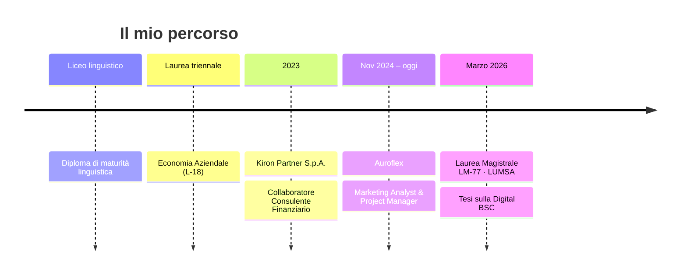

<!-- ════════════════════════════  HERO  ════════════════════════════ -->
<p align="center">
  
</p>

<p align="center">
  <a href="#-chi-sono">
    
  </a>
</p>

<p align="center">
  <a href="mailto:r.randazzo1@lumsastud.it"></a>
  <a href="#-tesi-sperimentale"></a>
  <a href="#-cosa-dicono-di-me"></a>
  
</p>

<p align="center"></p>

## 👋 Chi sono

<table>
<tr>
<td width="58%" valign="top">

```python
class Riccardo:
    ruolo       = ["Project Manager", "Marketing Analyst",
                   "AI Implementation"]
    formazione  = "LM-77 Economia e Management · LUMSA"
    superpotere = "far parlare la strategia con la tecnologia"
    lingue      = {"IT": "madrelingua", "EN": "B2",
                   "FR": "B1", "ES": "scolastico"}

    def missione(self):
        return ("Processi più snelli, tempi più corti, "
                "giornate più leggere per tutto il team.")
```

</td>
<td width="42%" valign="top">

**Profilo ibrido**: solide basi gestionali e finanziarie, più competenze tecniche nel digitale.

Prendo un processo aziendale, ne capisco il **perché**, e lo trasformo in uno strumento che funziona davvero, spesso grazie all'**intelligenza artificiale**.

🟢 &nbsp;Marketing Analyst & PM @ **Auroflex**<br>
🎓 &nbsp;Tesi sulla **Digital Balanced Scorecard**<br>
🤖 &nbsp;Strumenti di automazione basati su **LLM**

</td>
</tr>
</table>

<p align="center"></p>

## 🎓 Tesi sperimentale

<p align="center">
  <a href="https://github.com/rrandazzo1-sketch/rrandazzo1-sketch/raw/main/tesi/Riccardo_Randazzo_Tesi_Digital_BSC.pdf">
    
  </a>
</p>

<p align="center">
  <a href="https://github.com/rrandazzo1-sketch/rrandazzo1-sketch/raw/main/tesi/Riccardo_Randazzo_Tesi_Digital_BSC.pdf"></a>
  <a href="https://github.com/rrandazzo1-sketch/rrandazzo1-sketch/blob/main/tesi/Riccardo_Randazzo_Tesi_Digital_BSC.pdf"></a>
  
</p>

<details>
<summary><b>🔍 Di cosa parla, in 20 secondi</b> (clicca)</summary>
<br>

Le aziende manifatturiere B2B investono nel digitale, ma continuano a misurarsi quasi solo con indicatori finanziari tradizionali (ROI, ROS, EBITDA).
**Come si capisce se gli investimenti digitali stanno davvero funzionando?**

Partendo dal caso **Auroflex S.r.l.** (settore delle etichette autoadesive), la tesi:

1. 📑 analizza i **bilanci** e la solidità finanziaria dell'azienda;
2. 💻 traccia gli **investimenti digitali** e misura il gap di maturità digitale (sito, CRM, analytics);
3. 📋 integra una **customer satisfaction survey** e le **analytics dell'e-commerce**;
4. 🎯 costruisce una **Digital Balanced Scorecard**: una dashboard integrata di KPI operativi e digitali sulle quattro prospettive classiche, arricchita da variabili digitali trasversali.

</details>

<details>
<summary><b>🧭 Guarda lo schema della Digital Balanced Scorecard</b> (clicca)</summary>
<br>
<p align="center">
  
</p>
</details>

<sub>Relatrice: Prof.ssa Francesca Costanza · Correlatrice: Prof.ssa Letizia Lo Presti · Cattedra di Sistemi di misurazione della performance · Università LUMSA.<br>
© Riccardo Randazzo — tutti i diritti riservati. Citazioni consentite indicando l'autore.</sub>

<p align="center"></p>

## 🧭 Scegli il tuo percorso

<table>
<tr>
<td width="33%" valign="top">

<details>
<summary><b>🧑‍💼 Recruiter</b><br><sub>tutto in 30 secondi</sub></summary>
<br>

🎯 Marketing Analyst & PM @ Auroflex<br>
🤖 AI automation, prompt engineering<br>
📊 MySQL, DBeaver, Postman, Excel<br>
🛒 Shopify<br>
🗂️ PMO e budgeting<br>
🎓 LM-77 LUMSA (2026)

👉 [Contattami](mailto:r.randazzo1@lumsastud.it?subject=Opportunit%C3%A0%20di%20lavoro)
</details>

</td>
<td width="33%" valign="top">

<details>
<summary><b>🏢 Azienda</b><br><sub>cosa posso fare per voi</sub></summary>
<br>

⚙️ Automatizzare i flussi ripetitivi con LLM<br>
📈 Analizzare vendite, budget e ROI<br>
📐 Progettare KPI e scorecard digitali<br>
🔗 Integrare dati, API ed e-commerce<br>
🧩 Coordinare team eterogenei

👉 [Parliamone](mailto:r.randazzo1@lumsastud.it?subject=Collaborazione)
</details>

</td>
<td width="33%" valign="top">

<details>
<summary><b>👀 Curioso</b><br><sub>sorprendimi</sub></summary>
<br>

🏆 Presidenza e agonismo sportivo: la leadership l'ho imparata anche fuori dall'ufficio.<br><br>
💻 Sviluppo un'app desktop in **C++** con computer vision. Sì, un economista che scrive C++.<br><br>
🧠 L'AI non sostituisce le persone: le libera dalle cose noiose.
</details>

</td>
</tr>
</table>

<p align="center"></p>

## 🛠️ Toolbox

<p align="center">
  
</p>

<p align="center">
  
</p>

| 🤖 Tecnologia & AI | 📊 Business & Management | 🤝 Soft skills |
|:---|:---|:---|
| Advanced prompt engineering | Marketing analytics | Leadership e gestione team |
| Automazione processi con LLM | Budgeting strategico | Problem solving analitico |
| SQL, API testing, integrazioni | PMO e coordinamento | Comunicazione tra reparti |
| E-commerce Shopify | Performance measurement (BSC) | Affidabilità |

<p align="center"></p>

## 🚀 Esperienza



<details open>
<summary><b>🟣 Auroflex — Marketing Analyst & Project Manager</b> · <i>Nov 2024 – in corso</i></summary>
<br>

- 🤖 **AI Automation & Prompt Engineering**: progettazione e implementazione di strumenti basati su LLM per automatizzare i flussi di lavoro interni
- 📈 **Marketing Analytics & Budgeting**: analisi delle performance di vendita e gestione del budget commerciale per ottimizzare il ROI
- 🛒 **E-commerce Management**: gestione tecnica e commerciale del canale online su Shopify
- 🗄️ **Data Management**: estrazione dati con MySQL e DBeaver, integrazioni e test API con Postman
- 🗂️ **PMO & Coordinamento**: gestione del Project Management Office, rispetto delle deadline e raccordo tra i reparti
</details>

<details>
<summary><b>🔵 Kiron Partner S.p.A. — Collaboratore Consulente Finanziario</b> · <i>2023</i></summary>
<br>

- 🏦 **Analisi e consulenza**: merito creditizio, finanziamenti, mutui e soluzioni assicurative
- 👥 **Gestione clientela**: dall'analisi delle esigenze alla pianificazione patrimoniale personalizzata
- 📋 **Compliance**: documentazione conforme alle normative e rapporti con gli istituti bancari partner
- ⚖️ **Valutazione del rischio**: supporto alla definizione del profilo di rischio del cliente
</details>

<details>
<summary><b>🎓 Formazione</b></summary>
<br>

- **Laurea Magistrale in Economia e Management (LM-77)**, Università LUMSA, marzo 2026
  <br><sub>Strategia d'impresa · analisi finanziaria avanzata · modelli organizzativi · fintech e coding</sub>
- **Laurea in Economia Aziendale (L-18)**
  <br><sub>Contabilità e bilancio · economia politica · diritto commerciale e privato</sub>
- **Formazione in consulenza finanziaria**
  <br><sub>Pianificazione patrimoniale · mercati finanziari · compliance</sub>
- **Diploma di maturità linguistica**
</details>

<p align="center"></p>

## 💬 Cosa dicono di me

<table>
<tr>
<td>

> *«Ho visto in Riccardo qualcosa che raramente si trova: la capacità di ascoltare la visione dell'azienda e trasformarla in qualcosa di concreto, funzionante, vivo.»*

> *«Riccardo ha contribuito a portare in azienda strumenti di automazione basati su intelligenza artificiale e large language models, cambiando concretamente il modo in cui lavoravamo.»*

> *«Le persone come lui non si limitano a far funzionare i progetti, fanno funzionare meglio anche le squadre.»*

**Federica Vicari**
<br><sub>Responsabile Marketing e Comunicazione, Auroflex S.r.l.</sub>

</td>
</tr>
</table>

<details>
<summary>✨ <b>Il punto in cui mi ritrovo di più</b> (clicca)</summary>
<br>

> *«Riccardo non si accontenta mai della soluzione più semplice o più veloce: si ferma, valuta l'impatto reale sui processi aziendali, e trova la strada più giusta, non solo quella più comoda.»*

La lettera completa è disponibile su richiesta. 📩
</details>

<p align="center"></p>

## 📂 Progetti

<table>
<tr>
<td width="33%" valign="top">

### 🎓 Digital BSC
KPI finanziari e digitali integrati per una PMI manifatturiera B2B.

`Balanced Scorecard` `KPI` `Analisi di bilancio`

📄 *[Scarica la tesi](https://github.com/rrandazzo1-sketch/rrandazzo1-sketch/raw/main/tesi/Riccardo_Randazzo_Tesi_Digital_BSC.pdf)*

</td>
<td width="33%" valign="top">

### 🤖 Automazioni AI
Strumenti basati su LLM per snellire i processi di marketing e comunicazione.

`LLM` `Prompt Engineering` `Workflow`

🔒 *Progetto aziendale.*

</td>
<td width="33%" valign="top">

### 🎯 AccelLab
App desktop per giocatori FPS con computer vision on-device.

`C++20` `ONNX Runtime` `YOLO` `ImGui`

🔒 *Codice privato, demo in arrivo.*

</td>
</tr>
</table>

<p align="center"></p>

## 🎲 Quiz lampo

<details>
<summary><b>❓ Quanti ruoli diversi ho coordinato contemporaneamente in un solo progetto?</b></summary>
<br>

**Almeno 5!** Media buyer, advertiser, SEO specialist, web developer e web designer. Il segreto? Far dialogare mondi diversi senza far pesare la complessità. 🧩
</details>

<details>
<summary><b>❓ Quante prospettive ha la mia Digital Balanced Scorecard?</b></summary>
<br>

**Quattro**: finanziaria, cliente, processi interni, apprendimento e crescita. Più un livello di variabili digitali trasversali che le collega tutte. 🎯
</details>

<details>
<summary><b>❓ Cosa c'entra un economista con il C++?</b></summary>
<br>

Tutto! Capire *come* funziona la tecnologia mi aiuta a capire *cosa* può fare per un'azienda. 💡
</details>

<p align="center"></p>

## 📊 Attività su GitHub

<p align="center">
  
  
</p>

<p align="center">
  <picture>
    <source media="(prefers-color-scheme: dark)" srcset="https://raw.githubusercontent.com/rrandazzo1-sketch/rrandazzo1-sketch/output/github-contribution-grid-snake-dark.svg"/>
    
  </picture>
</p>

<p align="center"></p>

<p align="center">
  <b>Hai un processo che ti fa perdere tempo? Parliamone.</b><br><br>
  <a href="mailto:r.randazzo1@lumsastud.it?subject=Ciao%20Riccardo"></a>
  <a href="https://github.com/rrandazzo1-sketch/rrandazzo1-sketch/raw/main/tesi/Riccardo_Randazzo_Tesi_Digital_BSC.pdf"></a>
</p>

<p align="center">
  
</p>
