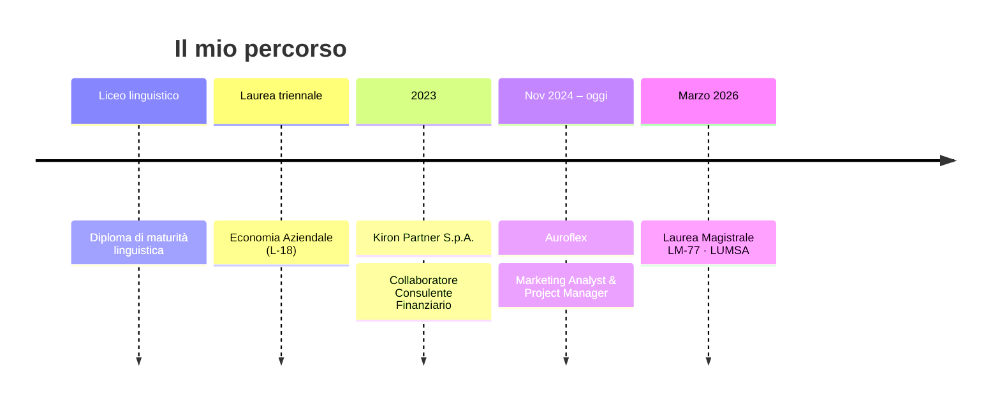

<!-- ═══════════════════════════  HEADER ANIMATO  ═══════════════════════════ -->
<p align="center">
  
</p>

<p align="center">
  <a href="#-chi-sono">
    
  </a>
</p>

<p align="center">
  <a href="mailto:r.randazzo1@lumsastud.it"></a>
  <a href="#-cosa-dicono-di-me"></a>
  <a href="#-progetti"></a>
  
</p>

---

## 👋 Chi sono

```python
class Riccardo:
    ruolo        = ["Project Manager", "Marketing Analyst", "AI Implementation"]
    base         = "Italia 🇮🇹"
    formazione   = "Laurea Magistrale in Economia e Management (LM-77) · LUMSA"
    superpotere  = "far parlare la strategia aziendale con la tecnologia"
    lingue       = {
        "Italiano": "madrelingua", "Inglese": "B2",
        "Francese": "B1",          "Spagnolo": "scolastico",
    }

    def missione(self):
        return ("Processi più snelli, tempi più corti, "
                "giornate più leggere per tutto il team.")
```

Ho un **profilo ibrido**: solide basi gestionali e finanziarie unite a competenze tecniche nel digitale.
Il mio lavoro è prendere un processo aziendale, capirne il **perché**, e trasformarlo in uno strumento che funziona davvero — spesso grazie all'**intelligenza artificiale**.

---

## 🧭 Scegli il tuo percorso

> Sei un recruiter? Un'azienda? Un curioso? Clicca la sezione che fa per te 👇

<details>
<summary><b>🧑‍💼 Sono un recruiter — dimmi tutto in 30 secondi</b></summary>
<br>

| | |
|---|---|
| 🎯 **Ruolo attuale** | Marketing Analyst & Project Manager @ Auroflex |
| 🤖 **Specialità** | AI automation, prompt engineering, strumenti basati su LLM |
| 📊 **Dati** | MySQL, DBeaver, Postman, Excel avanzato, marketing analytics |
| 🛒 **E-commerce** | Gestione tecnica e commerciale su Shopify |
| 🗂️ **Management** | PMO, budgeting, coordinamento team multidisciplinari |
| 🎓 **Titolo** | LM-77 Economia e Management — LUMSA (2026) |

👉 [Contattami via email](mailto:r.randazzo1@lumsastud.it?subject=Opportunit%C3%A0%20di%20lavoro)
</details>

<details>
<summary><b>🏢 Sono un'azienda — cosa puoi fare per noi?</b></summary>
<br>

- ⚙️ **Automatizzare** i flussi di lavoro ripetitivi con strumenti basati su LLM
- 📈 **Analizzare** vendite e performance per ottimizzare budget e ROI
- 🔗 **Integrare** dati e sistemi (query SQL, test API, e-commerce)
- 🧩 **Coordinare** team eterogenei — media buyer, advertiser, SEO, developer, designer — senza perdere il filo

👉 [Parliamo del tuo progetto](mailto:r.randazzo1@lumsastud.it?subject=Collaborazione)
</details>

<details>
<summary><b>👀 Sono solo curioso — sorprendimi</b></summary>
<br>

🏆 Ho esperienza di **presidenza e agonismo sportivo**: la leadership l'ho imparata anche fuori dall'ufficio.
💻 Nel tempo libero sviluppo un'app desktop in **C++** con computer vision. Sì, un economista che scrive C++.
🧠 Credo che l'AI non sostituisca le persone: le libera dalle cose noiose.
</details>

---

## 🛠️ Toolbox

<p align="center">
  
</p>

<p align="center">
  
  
  
  
  
  
  
</p>

| 🤖 Tecnologia & AI | 📊 Business & Management | 🤝 Soft skills |
|:---|:---|:---|
| Advanced prompt engineering | Marketing analytics | Leadership e gestione team |
| Automazione processi con LLM | Budgeting strategico | Problem solving analitico |
| SQL, API testing, integrazioni | PMO e coordinamento | Comunicazione tra reparti |
| E-commerce Shopify | Consulenza finanziaria | Affidabilità |

---

## 🚀 Esperienza



<details open>
<summary><b>🟣 Auroflex — Marketing Analyst & Project Manager</b> · <i>Nov 2024 – in corso</i></summary>
<br>

- 🤖 **AI Automation & Prompt Engineering** — progettazione e implementazione di strumenti basati su LLM per automatizzare i flussi di lavoro interni
- 📈 **Marketing Analytics & Budgeting** — analisi delle performance di vendita e gestione del budget commerciale per ottimizzare il ROI
- 🛒 **E-commerce Management** — gestione tecnica e commerciale del canale online su Shopify
- 🗄️ **Data Management** — estrazione dati con MySQL e DBeaver, integrazioni e test API con Postman
- 🗂️ **PMO & Coordinamento** — gestione del Project Management Office, rispetto delle deadline e raccordo tra i reparti
</details>

<details>
<summary><b>🔵 Kiron Partner S.p.A. — Collaboratore Consulente Finanziario</b> · <i>2023</i></summary>
<br>

- 🏦 **Analisi e consulenza** — merito creditizio, finanziamenti, mutui e soluzioni assicurative
- 👥 **Gestione clientela** — dall'analisi delle esigenze alla pianificazione patrimoniale personalizzata
- 📋 **Compliance** — documentazione conforme alle normative e rapporti con gli istituti bancari partner
- ⚖️ **Valutazione del rischio** — supporto alla definizione del profilo di rischio del cliente
</details>

<details>
<summary><b>🎓 Formazione</b></summary>
<br>

- **Laurea Magistrale in Economia e Management (LM-77)** — Università LUMSA, marzo 2026
  <br><sub>Strategia d'impresa · analisi finanziaria avanzata · modelli organizzativi · fintech e coding</sub>
- **Laurea in Economia Aziendale (L-18)**
  <br><sub>Contabilità e bilancio · economia politica · diritto commerciale e privato</sub>
- **Formazione in consulenza finanziaria**
  <br><sub>Pianificazione patrimoniale · mercati finanziari · compliance</sub>
- **Diploma di maturità linguistica**
</details>

---

## 💬 Cosa dicono di me

<table>
<tr>
<td>

> *«Ho visto in Riccardo qualcosa che raramente si trova: la capacità di ascoltare la visione dell'azienda e trasformarla in qualcosa di concreto, funzionante, vivo.»*

> *«Riccardo ha contribuito a portare in azienda strumenti di automazione basati su intelligenza artificiale e large language models, cambiando concretamente il modo in cui lavoravamo.»*

> *«Le persone come lui non si limitano a far funzionare i progetti, fanno funzionare meglio anche le squadre.»*

**— Federica Vicari**
<br><sub>Responsabile Marketing e Comunicazione, Auroflex S.r.l.</sub>

</td>
</tr>
</table>

<details>
<summary>✨ <b>Il punto in cui mi ritrovo di più</b> (clicca)</summary>
<br>

> *«Riccardo non si accontenta mai della soluzione più semplice o più veloce: si ferma, valuta l'impatto reale sui processi aziendali, e trova la strada più giusta, non solo quella più comoda.»*

La lettera completa è disponibile su richiesta. 📩
</details>

---

## 📂 Progetti

<table>
<tr>
<td width="50%" valign="top">

### 🎯 AccelLab
App desktop per giocatori FPS con **computer vision on-device**.

`C++20` `ONNX Runtime` `YOLO` `ImGui` `DirectX 11`

🔒 *Codice sorgente privato — demo e installer in arrivo.*

</td>
<td width="50%" valign="top">

### 🤖 Automazioni AI @ Auroflex
Strumenti basati su LLM per snellire i processi interni di marketing e comunicazione.

`LLM` `Prompt Engineering` `Workflow automation`

🔒 *Progetto aziendale.*

</td>
</tr>
</table>

---

## 🎲 Quiz lampo

<details>
<summary><b>Quanti ruoli diversi ho coordinato contemporaneamente in un solo progetto?</b></summary>
<br>

**Almeno 5!** Media buyer, advertiser, SEO specialist, web developer e web designer. Il segreto? Far dialogare mondi diversi senza far pesare la complessità. 🧩
</details>

<details>
<summary><b>Cosa c'entra un economista con il C++?</b></summary>
<br>

Tutto! Capire *come* funziona la tecnologia mi aiuta a capire *cosa* può fare per un'azienda. 💡
</details>

---

## 📊 Attività su GitHub

<p align="center">
  
  
</p>

<p align="center">
  <picture>
    <source media="(prefers-color-scheme: dark)" srcset="https://raw.githubusercontent.com/rrandazzo1-sletch/rrandazzo1-sletch/output/github-contribution-grid-snake-dark.svg"/>
    
  </picture>
</p>

---

<p align="center">
  <b>Hai un processo che ti fa perdere tempo? Parliamone.</b><br><br>
  <a href="mailto:r.randazzo1@lumsastud.it?subject=Ciao%20Riccardo"></a>
</p>

<p align="center">
  
</p>
